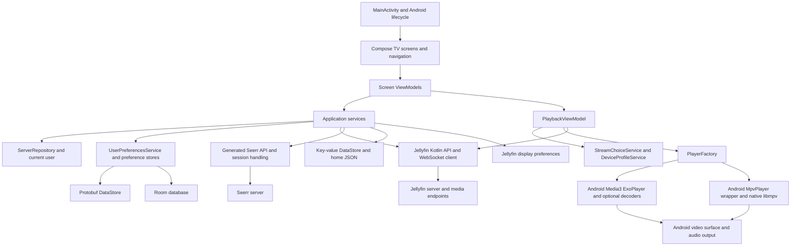

# Wholphin architecture and source map

Wholphin is a single-activity Android TV application with Compose screens, ViewModels, injectable services, local persistence, and Jellyfin API clients. Browsing and playback policy are reusable ideas and often reusable Kotlin, but they are interwoven with Android UI, lifecycle, storage, and player types. Running the APK preserves those dependencies; porting the app requires explicit boundaries around them.

All application links below are pinned to [`d6523ce`](https://github.com/damontecres/Wholphin/tree/d6523ce856f7066c35bc9df8b514a8d6b876f06c). The upstream [developer guide](https://github.com/damontecres/Wholphin/blob/d6523ce856f7066c35bc9df8b514a8d6b876f06c/DEVELOPMENT.md) describes the same overall organization.

## Annotated directory tree

```text
Wholphin_BUT_For_Web/
|-- AGENTS.md                         Continuing project purpose and fidelity rules
|-- research/                         This assessment and generated inventories
|-- tools/research/                   Small reproducible inspection tools
|-- .github/
|   |-- workflows/                    Android CI, tests, releases, extension downloads
|   `-- ...                           Issue templates and repository presentation assets
|-- app/
|   |-- build.gradle.kts              Android build, flavors, code generation, native artifacts
|   |-- proguard-rules.pro            Android release shrinking rules
|   |-- config/
|   |   |-- libraries/                Dependency attribution metadata
|   |   `-- licenses/                 License text metadata for bundled native dependencies
|   |-- schemas/...AppDatabase/       Versioned Room schemas through version 35
|   `-- src/
|       |-- appstore/                 Store-specific manifest overlay
|       |-- main/
|       |   |-- AndroidManifest.xml   Permissions, activity, intents, services, providers
|       |   |-- assets/               Subtitle font and Roboto fonts with their license
|       |   |-- proto/                WholphinDataStore.proto preference schema
|       |   |-- seerr/                OpenAPI specification and Kotlin generator template
|       |   |-- res/                  Strings, translations, images, layouts, XML and styles
|       |   `-- java/com/github/damontecres/wholphin/
|       |       |-- MainActivity.kt   Android entry point and application composition
|       |       |-- WholphinApplication.kt
|       |       |                     Application initialization and background work setup
|       |       |-- WholphinDreamService.kt
|       |       |                     Android OS screensaver integration
|       |       |-- api/seerr/        Hand-maintained Seerr API client infrastructure
|       |       |-- data/             Database, DAOs, server and playback repositories
|       |       |   |-- filter/       Search and discovery filter definitions
|       |       |   `-- model/        Stored and application domain models
|       |       |-- preferences/      Preference controls, defaults, updates and profile choices
|       |       |-- services/         API-facing and application orchestration services
|       |       |   |-- hilt/         Dependency injection and database/client construction
|       |       |   `-- tvprovider/   Android launcher recommendations and scheduled updates
|       |       |-- ui/               Screens, components, navigation and ViewModels
|       |       |   |-- cards/        Media cards and presentation variants
|       |       |   |-- components/   Grids, dialogs, reusable controls and view options
|       |       |   |-- data/         UI model and sorting support
|       |       |   |-- detail/       Movies, series, collections, music, live TV and detail pages
|       |       |   |-- discover/     Seerr discovery, requests and filters
|       |       |   |-- main/         Home rows and customization
|       |       |   |-- nav/          Destinations, backdrop, drawer and screen navigation
|       |       |   |-- playback/     Player state, playback policy, dialogs and keyboard handling
|       |       |   |   `-- overlay/  Controls, timeline, trickplay, chapters, queue, skip buttons
|       |       |   |-- preferences/  Settings screens and subtitle style editor
|       |       |   |-- search/       Results, filters and search state
|       |       |   |-- setup/        Server and user setup, including Seerr setup
|       |       |   |-- slideshow/    Photo browsing, slideshow and in-app screensaver
|       |       |   |-- theme/        Colors and shared UI styling
|       |       |   `-- util/         Formatting and display utilities
|       |       `-- util/
|       |           |-- mpv/         MPV-specific Jellyfin device profile
|       |           `-- profile/     Android decoder probing and ExoPlayer device profiles
|       |-- test/                     Unit, Robolectric and Compose test source
|       `-- androidTest/              Android instrumentation test source
|-- wholphin-mpv-stub/                Android Media3-compatible placeholder, not real MPV
|-- gradle/
|   |-- libs.versions.toml            Dependency and SDK version catalog
|   `-- wrapper/                      Pinned Gradle distribution and wrapper
|-- build.gradle.kts                 Root build plugin declarations
|-- settings.gradle.kts              Android modules and optional native Maven registry
|-- gradle.properties                Gradle and Android build settings
|-- gradlew / gradlew.bat             Portable Gradle launchers
|-- README.md                        Upstream product overview
|-- DEVELOPMENT.md / CONTRIBUTING.md Upstream development and contribution rules
|-- Intents.md                       Android deep-link and playback integration contract
`-- LICENSE                          Upstream GPL version 2 license
```

The tree groups resource variants and nested detail screens for readability. [Directory inventory](generated/directory-inventory.csv) lists every tracked upstream directory with descendant file counts and its source URL. Resource folders such as `values-iw` contain Hebrew localization; other `values-*` folders follow the same language-resource role. `drawable*`, `mipmap*`, `layout`, `xml`, and other resource variants are Android resource packaging, not independent application modules.

## Runtime relationships



Hilt constructs the graph in [`AppModule.kt`](https://github.com/damontecres/Wholphin/blob/d6523ce856f7066c35bc9df8b514a8d6b876f06c/app/src/main/java/com/github/damontecres/wholphin/services/hilt/AppModule.kt) and [`DatabaseModule.kt`](https://github.com/damontecres/Wholphin/blob/d6523ce856f7066c35bc9df8b514a8d6b876f06c/app/src/main/java/com/github/damontecres/wholphin/services/hilt/DatabaseModule.kt). Device identity comes from the SDK's Android device helper; authenticated OkHttp requests include the active user's Jellyfin authorization data. A port must retain server/user identity and client identity semantics while supplying a platform-appropriate device implementation.

## Main application flows

**Server and user setup.** [`SwitchServerViewModel.kt`](https://github.com/damontecres/Wholphin/blob/d6523ce856f7066c35bc9df8b514a8d6b876f06c/app/src/main/java/com/github/damontecres/wholphin/ui/setup/SwitchServerViewModel.kt) normalizes entered addresses, checks candidate servers, and invokes local discovery. [`SwitchUserViewModel.kt`](https://github.com/damontecres/Wholphin/blob/d6523ce856f7066c35bc9df8b514a8d6b876f06c/app/src/main/java/com/github/damontecres/wholphin/ui/setup/SwitchUserViewModel.kt) handles login and Quick Connect. [`ServerRepository.kt`](https://github.com/damontecres/Wholphin/blob/d6523ce856f7066c35bc9df8b514a8d6b876f06c/app/src/main/java/com/github/damontecres/wholphin/data/ServerRepository.kt) stores servers and users, updates the active API session, and exposes current-user state. Profile protection and per-user language are application behavior, not merely a login page.

**Browsing and customization.** Screen ViewModels make Jellyfin requests through services and SDK APIs. [`HomeSettingsService.kt`](https://github.com/damontecres/Wholphin/blob/d6523ce856f7066c35bc9df8b514a8d6b876f06c/app/src/main/java/com/github/damontecres/wholphin/services/HomeSettingsService.kt) resolves configurable home rows and saves them locally or on the server. [`NavDrawerService.kt`](https://github.com/damontecres/Wholphin/blob/d6523ce856f7066c35bc9df8b514a8d6b876f06c/app/src/main/java/com/github/damontecres/wholphin/services/NavDrawerService.kt) builds navigation and pinned items. Image URLs and caching are handled through `ImageUrlService` and Coil. Preserve ordering, pagination, exclusions, sorting, image choices, and focus restoration; changing the renderer does not justify changing those rules.

**Playback.** [`PlaylistCreator.kt`](https://github.com/damontecres/Wholphin/blob/d6523ce856f7066c35bc9df8b514a8d6b876f06c/app/src/main/java/com/github/damontecres/wholphin/services/PlaylistCreator.kt) builds contextual queues. [`StreamChoiceService.kt`](https://github.com/damontecres/Wholphin/blob/d6523ce856f7066c35bc9df8b514a8d6b876f06c/app/src/main/java/com/github/damontecres/wholphin/services/StreamChoiceService.kt) resolves source, audio and subtitle choices using user, series and item preferences. [`PlaybackViewModel.kt`](https://github.com/damontecres/Wholphin/blob/d6523ce856f7066c35bc9df8b514a8d6b876f06c/app/src/main/java/com/github/damontecres/wholphin/ui/playback/PlaybackViewModel.kt) negotiates media with Jellyfin, chooses playback URLs, controls the player, handles segments and next-up behavior, reports playback state, and receives server commands.

[`PlayerFactory.kt`](https://github.com/damontecres/Wholphin/blob/d6523ce856f7066c35bc9df8b514a8d6b876f06c/app/src/main/java/com/github/damontecres/wholphin/services/PlayerFactory.kt) creates either ExoPlayer or the MPV wrapper. ExoPlayer integrates optional FFmpeg audio, AV1 decoding, and the Android libass renderer. `PREFER_MPV` has a real selection rule: the current source chooses ExoPlayer for HDR, or for 4K with MPV hardware decoding disabled; otherwise it chooses MPV. Preserving that option requires preserving its behavior, not just copying its label. [Selection code](https://github.com/damontecres/Wholphin/blob/d6523ce856f7066c35bc9df8b514a8d6b876f06c/app/src/main/java/com/github/damontecres/wholphin/ui/playback/PlaybackViewModel.kt#L233).

[`PlaybackPage.kt`](https://github.com/damontecres/Wholphin/blob/d6523ce856f7066c35bc9df8b514a8d6b876f06c/app/src/main/java/com/github/damontecres/wholphin/ui/playback/PlaybackPage.kt) attaches Android player views and overlays. `PlaybackKeyHandler` interprets remote and keyboard events, including repeated D-pad seeking. `RefreshRateService` changes Android display modes through `MainActivity`. External playback uses Android intents and activity results. These are the main platform seams.

**Server events and reporting.** `ServerEventListener` subscribes to general commands and user updates; playback and music have their own command subscriptions. Resume state is produced by playback events and Jellyfin session reporting. `ServerReportService`, despite its name, sends diagnostic reports and logs; it is not the primary playback-progress policy. Preserve both functions separately.

**Seerr.** `SeerrService`, `SeerrServerRepository`, and the generated client implement discovery, requests, server configuration, and authentication. The OpenAPI specification and serializer template are tracked inputs; generated Kotlin under `app/build/generated/seerr_api` is a build output. The `firetv` flavor disables discovery, while `default` and `appstore` enable it. The reference feature set therefore depends on the APK flavor. [Build flags and generator](https://github.com/damontecres/Wholphin/blob/d6523ce856f7066c35bc9df8b514a8d6b876f06c/app/build.gradle.kts).

## Code to retain and platform adapters

| Area | Retain | Adapt for desktop or browser |
| --- | --- | --- |
| Data and domain policy | Model meaning, identifiers, filters, queues, selection priorities, segment and resume rules | JVM types and Android imports prevent automatic `commonMain` extraction |
| Preferences | Field numbers, enum meanings, defaults, migrations, limits, unit conversions and scopes | Storage implementation and settings controls |
| Server communication | Endpoint meaning, request parameters, user identity, event handling, reports | SDK transport, browser CORS and media authentication, local discovery |
| Home and library display | Existing row types, order, saved JSON, filtering and view options | Renderer, input, scaling and storage adapter |
| Compose UI | Screen organization, styling, assets and observable behavior | TV widgets, Android views, resource access, lifecycle, focus and pointer input |
| ExoPlayer | Android implementation and native decoders in the Android route | A browser or native Windows implementation requires another engine |
| MPV | Command semantics and track/state mapping | New desktop rendering and native bindings; Android `.so` and JNI are not Windows binaries |
| Device profile | Capability negotiation policy and overrides | Probe the actual target instead of advertising Android hardware capabilities |
| OS integration | User intent and contracts | DreamService, launcher provider, WorkManager, APK updates, voice recognition and intents need target-specific behavior |
| Tests | Existing examples and selection, migration, queue, display-mode cases | Android test harness does not become a browser test harness |

No application files need deletion during assessment. Keep native attribution, fonts, schema history, API specification, manifests, and CI even if a later target does not use all of them. Exclude regenerated build outputs, caches, signing material, and local dependencies from the research branch.

## Size and coupling evidence

| Main package | Kotlin files | Lines |
| --- | ---: | ---: |
| Entry points | 4 | 1,020 |
| API infrastructure | 1 | 87 |
| Data | 37 | 3,839 |
| Preferences | 8 | 2,277 |
| Services | 46 | 10,377 |
| UI | 275 | 69,173 |
| Utilities | 27 | 3,545 |

130 main Kotlin files import `android.*`; 154 import TV components; 41 import Media3; 86 import Hilt; 134 import Java types; 292 import non-Compose AndroidX types. Categories overlap, and some AndroidX libraries have multiplatform variants. These measurements show where investigation is needed; they do not establish a reuse percentage. [Source inventory and methodology](generated/source-inventory.json).
