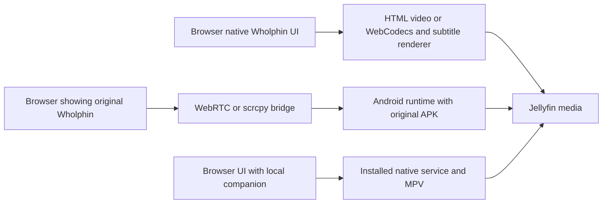

# Wholphin browser and desktop options

The most promising first experiment preserves Wholphin inside Android. The most promising native desktop architecture retains Kotlin application policy and uses a desktop MPV adapter. A browser-native application is feasible for much of the product, but it necessarily changes playback and operating-system integrations. No assessed route establishes perfect parity on all hardware.

## What running in the browser can mean

These are different products. Streaming executes the app on an Android host. A companion executes native playback on an installed computer process. A browser-native port executes its UI and media pipeline under browser APIs. Naming all three a web app would conceal important differences in installation, output quality, and feature fidelity.

## Comparison

| Route | Original Kotlin and settings | Same Android engines | Ordinary browser access | Main constraint |
| --- | --- | --- | --- | --- |
| Official Android emulator in a desktop window | Retained | Retained in guest | Requires a separate display bridge | Emulated media/output differs from physical TV |
| Android emulator plus WebRTC | Retained | Retained in guest | Yes | Capture, encoding, audio and browser output |
| Linux Android container plus streaming | Retained | Retained in container | Yes | Linux kernel, GPU and media-stack integration |
| Physical Android host plus scrcpy/browser bridge | Retained on real hardware | Retained on host | Yes with bridge | Host dependency, capture limitations and latency |
| Kotlin JVM and Compose desktop plus MPV | Much policy can be retained after separation | Native MPV; ExoPlayer requires Android | Desktop app; optional browser control | TV UI and native player adapters |
| Kotlin/Wasm or TypeScript browser-native port | Policy must be extracted or translated | Replaced by browser engines | Yes | SDK, storage, decoder and device API differences |
| Qt, Electron or Tauri web UI plus native MPV | Requires a ported UI and policy layer | Native MPV; ExoPlayer requires Android | Installed app; optional local web control | Native rendering, event bridge and distribution |
| Flutter port or adaptation of another client | Kotlin policy must be translated or served | Platform-dependent engines | Flutter web possible | Cross-platform UI does not ensure player parity |
| Whole-machine browser emulation | Possible research concept | Only if full compatible Android runs | In principle | No verified Wholphin result; large runtime and performance gaps |

The table is an assessment of architecture, not tested support.

## Official Android emulator

Wholphin declares an x86-64 APK split, and the pinned MPV extension builds x86-64 native libraries. The default flavor does not require Leanback hardware. These are concrete reasons to test an emulator instead of assuming an ARM-only television binary cannot run on a computer. [Application ABI and flavor configuration](https://github.com/damontecres/Wholphin/blob/d6523ce856f7066c35bc9df8b514a8d6b876f06c/app/build.gradle.kts), [MPV ABI configuration](https://github.com/damontecres/wholphin-extensions/blob/cbb4af14c8e61845440ef2281096fc05e8976027/wholphin-mpv/build.gradle.kts).

The official emulator supports ExoPlayer, but its support does not establish parity with a specific TV chipset, HDMI receiver, or display. Android's own media guidance recommends physical-device testing. Hardware acceleration for the virtual CPU and graphics is separate from hardware decoding of every media codec. [ExoPlayer emulator support](https://developer.android.com/media/media3/exoplayer/supported-devices).

For this Windows workspace, the starting point is an Android TV or suitable landscape Android x86-64 virtual device with the Windows Hypervisor Platform route. Keep the original package and engine behavior first. Determine whether TV focus controls accept pointer clicks before making a small input compatibility patch. Older [Wholphin issue 318](https://github.com/damontecres/Wholphin/issues/318) reports mouse problems on Android and Waydroid; its closed status is not proof of current compatibility.

This route is useful for both a development baseline and a desktop wrapper. Shipping a convenient consumer desktop application adds virtual-device provisioning, persistence, startup, audio, updates, and runtime distribution work. It is not yet a one-click desktop product.

## Android emulator with browser streaming

Google's current [`android-emulator-container-scripts`](https://github.com/google/android-emulator-container-scripts/tree/0aa7b0dc0556a8fa1827bf5c8a2f2a04e5301fb6) repository provides a React frontend, Python signaling gateway, and native emulator gRPC/WebRTC connection. Its frontend contains audio support and input handling. This is direct precedent for the proposed container/display concept, rather than a claim that an APK can be placed in an HTML page.

The documented container route needs Linux, Docker and KVM; it explicitly does not support Docker Desktop on Windows/macOS for KVM acceleration. The streaming example documents Linux and macOS emulator-discovery paths. Using its gateway with a native Windows emulator is a hypothesis to test, including the native RTC service, discovery path, and input behavior. A Linux host following the documented route is the clearer reference for an initial browser stream. [Requirements and streaming demo](https://github.com/google/android-emulator-container-scripts/blob/0aa7b0dc0556a8fa1827bf5c8a2f2a04e5301fb6/README.md).

The app receives media from Jellyfin, decodes it, composites UI and subtitles, and produces video/audio that the streaming path captures and encodes. The browser decodes that new stream. Original subtitle shapes can survive capture, but compression, scaling, color conversion, frame pacing, and audio buffering are additional variables. Source direct play inside Android does not mean the final browser presentation remains the untouched source stream.

The first go/no-go criteria should be capture of both player surfaces, continuous audio, Hebrew display and entry, seek recovery, and absence of growing audio/video drift. HDR and HDMI passthrough require a separate decision; the demo does not prove those capabilities. A browser streaming service also needs per-session state, access control, reconnect behavior and a deliberate network boundary around emulator debugging interfaces.

## Android containers and physical Android hosts

[`redroid`](https://github.com/remote-android/redroid-doc) runs Android in Linux containers and supports GPU-related configurations. It still depends on host kernel and graphics support. Its example ADB mapping is a debugging connection, not a browser player. A browser bridge must be added, and Android MediaCodec capabilities must be measured on that runtime. [`Waydroid`](https://docs.waydro.id/) is another Linux-oriented Android runtime suitable for a local desktop experiment. Neither provides a supported native Windows Docker shortcut equivalent to a browser APK runner.

[`Anbox Cloud`](https://documentation.ubuntu.com/anbox-cloud/explanation/anbox-cloud/) is a managed Android container and streaming architecture. It is relevant if many concurrent hosted sessions become the goal, but its infrastructure and service model are heavier than this project's first local experiment. No paid deployment or host provisioning is part of this assessment.

A physical Android host avoids emulated decoder differences. Native [`scrcpy`](https://github.com/Genymobile/scrcpy) can provide a computer window; [`ws-scrcpy`](https://github.com/NetrisTV/ws-scrcpy/tree/cd6cea6ebde17af6685c2b325183fc24bef9d52b) and [`Tango`](https://github.com/yume-chan/ya-webadb) provide browser-related precedents. Modern scrcpy audio forwarding requires Android 11 or later, with an additional startup condition on Android 11. A browser wrapper must actually implement that audio path; support in upstream scrcpy is not proof that every wrapper includes it. [scrcpy audio documentation](https://github.com/Genymobile/scrcpy/blob/master/doc/audio.md).

The pinned ws-scrcpy README describes ASCII-only text injection. That is a significant issue for Hebrew search/login entry even when Hebrew pixels display correctly. Test clipboard/IME or another Unicode input path before selecting the bridge. Its sample control surface includes shell and file management; a production viewer should expose only the app controls it needs. A dedicated physical device also needs to stay available whenever the browser is used.

## Kotlin JVM and Compose desktop

This route offers the strongest opportunity to reuse existing Kotlin policy in a real desktop app. Keep the current Android target and extract narrow interfaces for storage, resources, device identity, lifecycle, input, media capabilities, and playback. Existing Java UUID/time code and the JVM Jellyfin SDK can remain usable in a JVM target. The same code is not automatically usable in Wasm. [SDK platform scope](https://github.com/jellyfin/jellyfin-sdk-kotlin).

Compose Multiplatform supports desktop and browser targets, but Android-only APIs and unported libraries remain boundaries. Wholphin uses Android TV Material components, Hilt Android, Android views, platform resources and Android media types. The first UI experiment should port one real browsing screen and one settings group, not attempt to compile the entire application into `commonMain`. [Compose platform support](https://kotlinlang.org/docs/multiplatform/compose-compatibility-and-versioning.html), [Android-only APIs](https://kotlinlang.org/docs/multiplatform/compose-android-only-components.html).

The MPV wrapper is not a portable Kotlin player implementation: it imports Android `Surface`, `SurfaceView`, `Looper`, and Media3, and configures `gpu-context=android` and MediaCodec decoding. A desktop adapter needs a real desktop libmpv build, a rendering surface or native window, event-thread handling, track mapping, subtitles and a capability profile. Preserve command and state semantics, while using appropriate Windows/macOS/Linux options. [Pinned wrapper implementation](https://github.com/damontecres/wholphin-extensions/blob/cbb4af14c8e61845440ef2281096fc05e8976027/wholphin-mpv/src/main/java/com/github/damontecres/wholphin/mpv/MpvPlayer.kt).

Desktop MPV can be a strong engine, but it does not recreate the ExoPlayer option or the existing `PREFER_MPV` fallback. Retaining those exact engines still requires an Android runtime. This is the main reason to keep the runtime experiment ahead of a native desktop rewrite.

## Browser native Kotlin or TypeScript

Kotlin/Wasm can execute Kotlin/Compose web code; it does not supply Android framework classes or load Android native `.so` files as browser libraries. Wholphin's currently selected Jellyfin SDK transport is JVM/Android, its preference classes are generated for Java/Kotlin, and local discovery uses JVM UDP sockets. Each needs a browser-compatible implementation. HTTP/API behavior can be preserved using generated web clients or explicitly matched requests.

An HTML video pipeline with HLS/DASH support and a dedicated subtitle renderer is the practical initial design. Probe decoder/container support and let Jellyfin direct play, remux, or transcode appropriately. JASSUB demonstrates libass in WebAssembly for ASS subtitles, but extracting embedded subtitles, loading font attachments, measuring subtitle timing, and reproducing preferences remain application work. [JASSUB](https://github.com/ThaUnknown/jassub).

WebCodecs provides low-level audio/video codec APIs, not a full MPV replacement. A custom pipeline still needs demuxing, timestamps, buffering, seeking, track switches, rendering, and an audio clock. The specification does not require every codec to be available. [WebCodecs specification](https://www.w3.org/TR/webcodecs/), [demuxing and codec scope](https://developer.mozilla.org/en-US/docs/Web/API/WebCodecs_API).

For the local probe, Chrome advertises the tested HEVC configuration, so a blanket claim that browsers cannot play HEVC would be wrong. Conversely, that result does not establish every HEVC profile, HDR output, hardware decoding, or MKV streaming. AC-3/E-AC-3/DTS/TrueHD were not advertised for the tested configurations. WASM software decoding can potentially extend some format support, but does not grant HDMI bitstream output or Android display controls. See [actual probe results](generated/browser-capabilities.json).

## Web interface with native MPV

[`Jellyfin Desktop`](https://github.com/jellyfin/jellyfin-desktop/tree/2cb4a4456fd29b5b62d825ef0e5df93ed6913328) demonstrates a Qt WebEngine interface with native libmpv and platform display code. Its browser-like interface drives a native player through a privileged bridge. That pattern can provide broad local playback without server transcoding, while keeping UI overlays and navigation convenient.

Electron or Tauri can also pair web UI with an installed native player process. Tauri supports platform-specific sidecar binaries. Packaging Electron alone does not make HTML video equivalent to MPV; an actual player adapter is necessary. [Tauri sidecars](https://v2.tauri.app/develop/sidecar/).

A companion contacted from an ordinary browser usually renders native MPV in its own window or in an installed shell. Streaming its pixels back into the tab reintroduces the capture pipeline. Keep that distinction explicit. Control messages need a scoped native API and authenticated local session, rather than exposing arbitrary MPV commands or operating-system execution to any web origin. The companion must bind to the intended interface and handle reconnect/stop/session reporting reliably.

This route requires a ported Wholphin frontend or a shared Kotlin service process; it does not directly load the existing Compose Android UI. It may be attractive after the runtime experiments if local playback quality is prioritized over retaining both Android engines.

## Flutter and existing clients

[`Fladder`](https://github.com/DonutWare/Fladder/tree/91992fcd48cd83baaac1a979345e386e43beddc0) is valuable UI and architecture inspiration: responsive layouts, computer input, Seerr integration, and desktop/web distribution already exist. Its pinned source uses multiple player adapters and explicitly enables media-kit libass only outside the web target. A single Flutter UI therefore still has different native and browser playback capabilities. [Player configuration](https://github.com/DonutWare/Fladder/blob/91992fcd48cd83baaac1a979345e386e43beddc0/lib/wrappers/players/lib_mpv.dart#L78).

Adopting Flutter means translating Wholphin's Kotlin policy to Dart, or keeping it in a separate service. Starting from another client's UI also means matching every Wholphin setting, queue rule, preference scope, and server interaction. It is not a path to automatic feature parity. Review exact licenses before copying implementations; Wholphin and Fladder do not present the same license version.

## Browser emulation and privileged web apps

[`v86`](https://github.com/copy/v86) demonstrates x86 emulation in a browser using WebAssembly. That establishes that substantial machine emulation is possible, not that modern Wholphin plus Android media acceleration runs well there. This assessment found no verified Wholphin result for that route. A whole compatible Android system, graphics/media integration, memory, storage, input, networking, and performance would all need validation. Keep it as research, not the delivery baseline.

An installable PWA still uses ordinary browser media and OS APIs. Chrome's Direct Sockets can address some raw networking needs, but is restricted to explicitly installed Isolated Web Apps; it is not available to a normal browser page. An extension/native host can bridge other capabilities but adds installation and maintenance. These mechanisms do not supply Android ExoPlayer or its display/audio stack. [Direct Sockets scope](https://developer.chrome.com/docs/iwa/direct-sockets).

Windows Subsystem for Android is unsuitable as the new foundation: Microsoft records its removal from Store availability from 5 March 2025. Use a currently supported runtime route for a new project. [Microsoft's WSA notice](https://learn.microsoft.com/en-us/previous-versions/windows/android/wsa/).

## Decision for the next stage

Spend the first implementation effort proving original APK playback and usable input on a computer. Add browser streaming only after local runtime playback passes. If it succeeds for the user's media, it preserves far more application behavior than a rewrite. If output fidelity or ergonomics fail, the evidence should drive a Kotlin/native MPV desktop port. A pure browser client can follow with documented differences; it must not be presented as meeting the original all-features-unchanged requirement.
