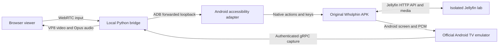

# Original Wholphin running on Windows and in a browser

Experiment date: 11 October 2026. This report supersedes the assessment's pending SDK, build, and playback checks.

The original upstream Wholphin APK now runs in an Android TV emulator on this computer. Both real ExoPlayer and MPV played the local H.264/AAC sample. A local browser viewer receives the actual Android screen and audio over WebRTC and sends keyboard, mouse, and Unicode text input back to Android. Wholphin's application source was not modified.

This establishes a working **streamed Android prototype**. It does not establish complete browser-native or hardware parity. The viewer currently negotiates VP8 video and Opus audio at 1280 × 720, with about 21–25 displayed frames per second on this machine. Mouse buttons and subtitle selection work through a separate accessibility adapter; arbitrary pointer seeking still needs work.

## Use the installed prototype

From the workspace in PowerShell:

```powershell
.\tools\runtime\start-lab.ps1
```

Open [the local viewer](http://127.0.0.1:18765/) and click **Connect**. Click the screen to give it keyboard focus. Arrow keys navigate, Enter selects, Escape goes back, and Space plays or pauses. The buttons below the screen provide the same remote actions. Sound starts muted; click **Sound off** to enable it.

Click native buttons in the streamed image. For text entry, activate the original Wholphin field with Enter first, type in the browser's text box, then click **Send text**. This successfully entered `שלום עולם 123` in Wholphin's search field. The adapter requires an editable field to be focused; it reports an error otherwise. Original Android keyboard controls remain available.

The isolated lab is already signed in to its own Jellyfin test account. The library contains two original synthetic clips. Change engines through the original **Settings → Advanced Settings → Playback Backend** menu. The source release offers ExoPlayer, MPV, Prefer MPV, and External Player; this experiment exercised ExoPlayer and MPV.

Restart the viewer after editing its Python code:

```powershell
.\tools\runtime\start-viewer.ps1 -Restart
```

Stop the dedicated emulator and viewer while retaining their data:

```powershell
.\tools\runtime\stop-lab.ps1
```

Add `-StopServer` to stop the isolated Jellyfin container too. These scripts check the emulator name, viewer command line, and container's config mount before operating on them. They do not remove data or stop unrelated services. A cold boot, restored sign-in, retained backend preference, authenticated capture, and browser reconnect were exercised.

## Precisely what was tested

| Check | Observed result | Scope |
| --- | --- | --- |
| SDK and acceleration | Installed; WHPX reports usable and the emulator boots | Windows 11, x86_64 Android TV API 36 |
| Original release authenticity | APK SHA-256 matches the upstream release asset; APK contains real MPV and other native libraries | Stable v1.0.8 x86_64 APK |
| ExoPlayer video/audio | Moving test pattern, nonzero captured PCM, Jellyfin DirectPlay | H.264 720p30 SDR + AAC mono in MKV |
| MPV video/audio | Moving test pattern, nonzero captured PCM, Jellyfin DirectPlay | Same media and server; selected through the original settings |
| Hebrew SRT | Hebrew letters, mixed English/numbers and punctuation visible in both engines; combining marks visible in ExoPlayer | Visual smoke tests, not a font/pixel golden test |
| Hebrew ASS | Hebrew combining marks visible in MPV; multiline Hebrew/English visible in ExoPlayer; yellow top-right positioned text visible in both | Embedded ASS selected in the original caption menu |
| Native keyboard | D-pad, center, Back, media pause/play and caption controls exercised | Ordinary Enter was less reliable than D-pad center on TV cards; browser Enter maps to center |
| Direct pointer input | Raw ADB mouse/touch taps and emulator gRPC mouse events did not reliably activate TV controls | Recorded before introducing an adapter |
| Adapter mouse input | Browser clicks opened Search, Settings, Advanced Settings, selected ExoPlayer, and selected Hebrew SRT | Native accessibility click actions, with a focus/center fallback |
| Pointer seekbar | The tested click focused/committed the existing position instead of seeking to the pointer position | Not passed; generic mouse/drag parity remains incomplete |
| Browser keyboard and Hebrew entry | Browser keys navigated Android; Space paused/resumed; Escape left playback; Hebrew text appeared in native Search | WebRTC data channel → input adapter |
| Browser video | Actual playback and subtitles appeared; negotiated VP8, 1280 × 720, roughly 21–25 fps | Local in-app browser; target capture rate is 30 fps |
| Browser audio | Opus packets received; nonzero `totalAudioEnergy` while playback was unmuted | Captured Android output, not a physical speaker/receiver test |
| Pause/resume transport | Audio continues as silence while Android is paused; resumed playback produces audio again | Fixed the original bridge's stalled audio clock; no measured lip-sync claim |
| gRPC boundary | Final listener is 127.0.0.1:8560; unauthenticated screenshot request rejected with UNAUTHENTICATED | Short-lived emulator token read locally and never sent to the page |
| Source APK assembly | Passed with real MPV, FFmpeg and AV1 AARs present | Current pinned main source; a separate build from the release APK used for playback |
| Upstream JVM tests | 378 passed, 4 failed out of 382, across 48 suites | All four failures are Windows DataStore temporary-file rename IOExceptions in ServerRepositoryTest; isolated retry reproduced 4/12 failures |

The test failures were not repaired by changing Wholphin's application or tests. Their messages concern renaming `test_datastore.pb.tmp` to `test_datastore.pb`, with the DataStore multiple-instance/file-usage diagnostic. This is consistent with test lifecycle/file locking on Windows; the precise root cause is not proven. It is not an all-green upstream test run.

Captured native audio was 48 kHz, stereo signed 16-bit PCM. Three-second captures contained 577,316 bytes for ExoPlayer and 580,992 bytes for MPV, with RMS values of 28.81 and 28.83 respectively. A later ExoPlayer capture during browser streaming contained 578,408 bytes with RMS 28.84. The deliberately quiet 440 Hz sample still produced measurable browser audio energy. These observations prove output capture, not audio passthrough, channel-layout fidelity or audio/video alignment.

One browser connection remained active for over ten minutes while switching views, pausing and resuming, changing engines and entering text. Sampled browser statistics showed zero packet loss and zero dropped video frames in that connection. This was not ten minutes of uninterrupted movie playback and is not the proposed hour-long synchronization test.

Jellyfin reported pause and playback position, and DirectPlay, in the lab session. After an ExoPlayer subtitle change, the caption menu and rendered positioned ASS proved the selected track, while an immediately sampled Jellyfin session still reported the previous subtitle index. Do not use the server's immediate subtitle index as sole proof of rendering or claim reporting fidelity is fully validated.

## Visual evidence

All images below are screenshots of this lab, with original synthetic media and disposable lab-account identifiers. No real library or server credentials are included.

- [Original player choices inside the browser](evidence/browser-original-backends.png)
- [Final authenticated browser session](evidence/browser-runtime-final.png) and [its sampled WebRTC diagnostics](evidence/browser-authenticated-diagnostics.json)
- [Hebrew Unicode input in Wholphin's native search field](evidence/browser-hebrew-input.png)
- [ExoPlayer positioned Hebrew ASS, streamed into the browser](evidence/browser-exoplayer-ass.png)
- [ExoPlayer native SRT combining marks](evidence/exoplayer-srt-niqqud.png)
- [ExoPlayer native ASS multiline text](evidence/exoplayer-ass-multiline.png)
- [MPV native ASS combining marks](evidence/mpv-ass-niqqud.png)
- [MPV native positioned Hebrew ASS](evidence/mpv-ass-positioned.png)

The engines display different font shapes and some mixed-direction punctuation arrangements. Those differences are visible before streaming. The bridge preserves the rendered image, subject to resizing and video compression; it does not reimplement subtitle shaping, bidirectional ordering, settings or playback policy in JavaScript.

## Runtime design and ports



The emulator provides its Android environment, player libraries, storage and original network stack. Wholphin still owns authentication, playback decisions, track selection, subtitles, settings and Jellyfin session reporting. The small helper APK owns only input adaptation. Python captures Android output and encodes it for WebRTC. The browser renders that stream and provides controls.

| Listener/connection | Final experiment configuration |
| --- | --- |
| Browser HTTP/signaling | 127.0.0.1:18765; Host and Origin restricted to this local origin |
| Emulator gRPC capture | 127.0.0.1:8560; `-grpc-use-token`; token required |
| Native input adapter | Guest 127.0.0.1:18666, forwarded by ADB to host 127.0.0.1:18666 |
| Emulator console / ADB | Dedicated emulator-5560; AVD WholphinTV36; console on loopback |
| Lab Jellyfin | Host 127.0.0.1:18096 → container 8096; Android accesses host loopback through 10.0.2.2:18096 |
| WebRTC media | OS-assigned UDP host candidates; no external STUN/TURN server |

The first emulator launch used the explicit `-grpc` port without token authentication and bound to the IPv6 wildcard. Before leaving the prototype running, it was restarted with `-grpc-use-token`, which bound capture to loopback. A negative unauthenticated capture test and a successful authenticated capture test both passed. Browser JavaScript never receives that credential or Jellyfin's token. Authentication data, Android userdata, generated protobuf bindings, builds, and downloads are excluded from Git under `.research-cache/` or existing build/library ignore rules.

This remains a local single-viewer lab. A new viewer replaces the previous WebRTC peer. Internet hosting, multi-user isolation, remote authentication, HTTPS deployment and LAN discovery are separate engineering work. The local loopback design is the tested deployment.

## Versions and artifacts

| Component | Exact tested identity |
| --- | --- |
| Host | Windows 11 build 26200; Ryzen 9 9950X3D, 32 logical processors, about 31 GiB RAM; RTX 5070 Ti |
| Source checkout | `d6523ce856f7066c35bc9df8b514a8d6b876f06c`, v1.0.8-17-gd6523ce8 |
| Playback APK | Upstream v1.0.8 x86_64; version 1.0.8-0-g7af7bc0a; release commit `7af7bc0aa70229fda6222f2d17d1b1ddbc2373c5` |
| APK SHA-256 | `74ba578c1059968c10c0884cc290d74a84793d9b78713beb0805baef7fb0a53f` |
| SDK command-line tools | 23; official Windows archive `commandlinetools-win-16111833_latest.zip`; vendor SHA-1 `57d04f2d75eb8e8fffc5000a987e5de4b5a63e9d` verified |
| SDK packages | platform-tools 37.0.1; emulator 37.2.12 build 16428233; platform android-37.0; build-tools 37.0.0 |
| AVD image | system-images/android-36/android-tv/x86_64, revision 4; tv_1080p; 4 GiB memory, 4 cores, host GPU |
| Build | JDK 21.0.10, Gradle 9.6.1; source compile/target SDK 37 unchanged |
| Python bridge | Python 3.13; aiortc 1.15.0, aiohttp 3.14.4, av 17.1.0, grpcio 1.84.0, protobuf 7.36.2 |
| Other host tools | Node 24.14.0, Docker 29.2.1, local FFmpeg |
| Jellyfin | Official 10.11.9 image, digest `sha256:bc9fa8e1462fffe3d8d4255fc62af478602641f4c0e5f4875fea8563d1189837` |
| Native extension source | v0.2.4, `cbb4af14c8e61845440ef2281096fc05e8976027` |

The stable release APK, rather than the debug APK assembled from newer main, was used for playback. The release bundles actual MPV/FFmpeg/AV1/libass native libraries and needs no package-registry credentials to run. The user's own installed TV version and preferences were not supplied, so this is an upstream reference, not a comparison against their personal TV.

The GitHub package-registry request for build extensions returned 401. The matching official upstream Actions artifact was available and was fetched using the already configured GitHub credential, without logging or saving that credential. Artifact **10279580428**, from run **34638348625**, records the exact extension commit above. Its archive digest is `46c8101b3f333a9306088ddff49a2d150d483560b65614a3783a1c7cc12efb5d`; Actions lists expiry on 10 December 2026. The resulting files were copied into the upstream-supported, ignored `app/libs/` directory:

| AAR | SHA-256 |
| --- | --- |
| lib-decoder-av1-release.aar | `249f7de33835f319a0d5a5afc50c79d1215ced2cd7409aa117478e5ccf86a53b` |
| lib-decoder-ffmpeg-release.aar | `817c9271ca98f8436e9a32c3343796c6f6c7f06cf424d8e90b279298fde3478f` |
| wholphin-mpv-release.aar | `5a3853dc64f2938bbfbb635f92261d0a9f4587f60fc82c31b0a69a39d5da6432` |

The full media test consisted of a 90-second 1280 × 720, 30 fps, H.264 SDR synthetic pattern, AAC mono 48 kHz quiet tone, external Hebrew SRT/ASS, and a remuxed MKV with default Hebrew SRT plus a second Hebrew ASS track. MKV video/audio/subtitle indexes were 0/1/2/3. Embedded subtitles were exercised in both engines. External files were indexed by Jellyfin but external-track playback has not been independently certified.

## Reproduce setup on another Windows host

The launch scripts reuse the installed lab. They do not download an SDK, recreate a server or replace application state on every launch. A fresh host needs JDK 21, Node, Python 3.13, FFmpeg, Docker, sufficient disk space, and a working Windows Android hypervisor. Follow the official [Android emulator acceleration guide](https://developer.android.com/studio/run/emulator-acceleration).

1. Download [Google's verified command-line tools archive](https://dl.google.com/android/repository/commandlinetools-win-16111833_latest.zip). Place its contents under `.research-cache/android-sdk/cmdline-tools/latest/` so `bin/sdkmanager.bat` exists. Dot-source `tools/runtime/environment.ps1`; this scopes SDK and AVD paths to the workspace.
2. Review/accept the SDK licenses through `sdkmanager.bat --licenses`. Install the following packages using the current tools' slash-style identifiers:

   ```powershell
   & $WholphinSdkManager --sdk_root=$WholphinSdk 'platform-tools' 'emulator' 'platforms/android-37.0' 'build-tools/37.0.0' 'system-images/android-36/android-tv/x86_64'
   & $WholphinEmulator -accel-check
   ```

3. Create the AVD. This `avdmanager` still uses semicolon-style identifiers:

   ```powershell
   'no' | & $WholphinAvdManager create avd --name WholphinTV36 --package 'system-images;android-36;android-tv;x86_64' --device tv_1080p --path (Join-Path $WholphinRuntime 'avd/WholphinTV36.avd')
   ```

4. Download [the original upstream release APK](https://github.com/damontecres/Wholphin/releases/download/v1.0.8/Wholphin-x86_64.apk) to `.research-cache/runtime/Wholphin-v1.0.8-x86_64.apk`. Verify the SHA-256 above. The launcher also verifies it before a first install.
5. Run `tools/runtime/prepare-streaming.ps1` to create the private virtual environment, install pinned direct dependencies, and generate SDK protobuf bindings. Build the separate controller:

   ```powershell
   .\gradlew.bat -p .\tools\runtime\automation-app assembleDebug
   ```

6. Generate the fixtures with `node tools/runtime/create-media.mjs`. Create an isolated Jellyfin container named `wholphin-runtime-jellyfin`, with the config/cache/media directories under `.research-cache/runtime/jellyfin/`, read-only `/media`, and only `127.0.0.1:18096:8096` published. The recorded official image digest above provides a pinned reference. Run `node tools/runtime/lab-server.mjs setup` after the empty server responds. This creates only a disposable lab user and media library; no Internet metadata providers or automatic port mapping are enabled.
7. Run `start-lab.ps1`. In original Wholphin, add `http://10.0.2.2:18096`, then use Quick Connect. Authorize the shown six-digit code with `node tools/runtime/lab-server.mjs authorize CODE`. This helper keeps credentials in excluded local state. Never commit that file.
8. Run `grpc-probe.py` through the lab virtual environment to check authentication and screenshot capture. Test the same sample in each engine through original settings. Use `lab-server.mjs sessions` for curated session state and `emulator-control.py audio 3 NAME.wav` for a local PCM measurement. Keep logs and recordings in the excluded runtime cache.

For a newer source build, obtain extensions for the pinned source from the official registry/build instructions or build [the pinned extension source](https://github.com/damontecres/wholphin-extensions/tree/cbb4af14c8e61845440ef2281096fc05e8976027). Do not substitute a successful compile using the MPV stub for a native playback test. Then run `:app:assembleDefaultDebug` and `:app:testDefaultDebugUnitTest`, recording the source-build and playback-APK versions separately.

## Toolkit map

```text
tools/runtime/
├── environment.ps1        SDK/cache paths scoped to this shell
├── start-lab.ps1          Reuse/start owned Jellyfin, AVD, adapter and viewer
├── start-viewer.ps1       Verified background Python launcher and restart
├── stop-lab.ps1           Stop only owned runtime processes; retain data
├── prepare-streaming.ps1  Python environment and SDK protobuf generation
├── requirements.txt       Tested direct Python dependency versions
├── create-media.mjs       Original synthetic video, tone and subtitle fixtures
├── lab-server.mjs         Isolated lab setup, Quick Connect and safe observations
├── emulator_rpc.py        Read the dedicated emulator's token without logging it
├── grpc-probe.py          Negative auth test, authenticated status and screenshot
├── emulator-control.py    Published gRPC input, framebuffer and PCM measurements
├── control.mjs            CLI client for the native input adapter
├── ui-snapshot.ps1        ADB screenshot and UI inventory fallback
├── stream-server.py       Local signaling, framebuffer/PCM capture and WebRTC
├── viewer.html            Browser screen, remote controls, text and diagnostics
└── automation-app/        Separate instrumentation APK; native actions and keys
```

The helper uses `UiAutomation` on API 33+ and clears the accessibility cache before resolving a target, so reused Compose virtual nodes do not point at a previous view. It limits actions to visible Wholphin windows. It is a development adapter, not a production accessibility service or a desktop installer. A foreground Windows emulator window is not required for the browser experiment.

The bridge obtains RGBA frames from the SDK's published controller API and captures Android PCM with `streamAudio`. It uses bounded audio buffering and continuous 20 ms RTP frames, including silence when the emulator stops emitting PCM. Video and audio use a shared time origin. This reduces an identifiable pause/resume clock problem but does not prove perceptual synchronization. The separate browser counters show media codec, decoded frames, packet loss and input acknowledgement timing; server handler timing is not end-to-end visual response latency.

## Decision and remaining acceptance gates

Continue the runtime approach as the closest route to keeping Wholphin's policy, settings and both native engines intact. This experiment removed the SDK, MPV-artifact and basic browser-capture uncertainties. It also demonstrates the costs of this route: a large installed Android runtime, a separate input adapter, compressed screen output and limited performance in the current bridge.

Before calling this a finished product, complete pointer focus/drag/seek semantics; test actual TV media, external subtitles/fonts and complex ASS; measure audio/video/subtitle synchronization through repeated seek, pause, rate changes and an hour-long run; compare settings/profile persistence; verify remux/transcode/live TV/network failures and LAN discovery; benchmark 1080p/4K and hardware encoding; and define desktop packaging and update behavior.

HDR, Dolby Vision, refresh-rate/resolution switching, receiver passthrough, TrueHD/DTS/Atmos fidelity, external-player intents, Seerr integration and every preference were **not** validated. VP8/Opus screen streaming is not an unchanged HDMI/HDR/bitstream output path. The original engines remain inside Android, but the browser receives their rendered/decoded output. Full literal TV output parity remains outside what this prototype establishes.

The original [architecture](architecture.md), [settings inventory](settings-and-parity.md), [platform options](platform-options.md) and [prior art](prior-art.md) still apply. For primary platform references, see Google's [emulator command-line documentation](https://developer.android.com/studio/run/emulator-commandline), the [Google emulator container/streaming project](https://github.com/google/android-emulator-container-scripts), the installed SDK's `emulator_controller.proto`, Android's [UiAutomation API](https://developer.android.com/reference/android/app/UiAutomation), and [aiortc's API documentation](https://aiortc.readthedocs.io/en/latest/api.html). This Windows bridge borrows the capture/control pattern from Google's project; it does not claim to run its Linux container stack or its browser WebRTC gateway unchanged.
